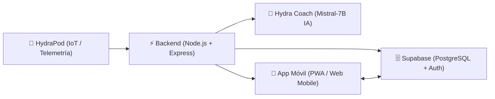

# 💧 HYDRA - Monitoreo y Gestión Inteligente del Consumo Energético

> **Documento de Resumen Ejecutivo y Técnico del Proyecto**  
> **Fecha:** Noviembre 2026  
> **Tecnologías:** Node.js, Express, Supabase (PostgreSQL, Auth, RLS), Hugging Face (Mistral-7B), PWA, Vanilla JS Mobile-First.

---

## 1. 🎯 ¿En qué consiste el proyecto HYDRA?

**HYDRA** es una solución integral orientada al **monitoreo, control y gestión inteligente del consumo de agua y energía eléctrica en calentadores de ducha**, utilizando el asistente inteligente **HydraPod**.

El proyecto transforma el ahorro de recursos en una experiencia interactiva y gamificada para el hogar y la familia:
- **Medición y telemetría en tiempo real:** Lecturas continuas de flujo de agua ($L/\text{min}$), potencia consumida ($W$), energía acumulada ($kWh$), temperatura ($^\circ C$) y costo monetario estimado.
- **Inteligencia Artificial (*Hydra Coach*):** Analiza el perfil de cada ducha, evalúa el comportamiento térmico y volumétrico, propone metas diarias adaptativas de reducción de consumo y ofrece consejos accionables en lenguaje natural.
- **Gamificación y comunidad:** Sistema de puntuación por eficiencia, niveles de usuario, ranking familiar semanal y retos grupales (ahorrar $X$ litros en $Y$ días).
- **Enfoque Móvil-First / PWA:** Interfaz optimizada para teléfonos móviles, instalable como aplicación nativa mediante Progressive Web App.



---

## 2. 🏛️ Arquitectura del Sistema

### 📱 Frontend (Cliente Web & PWA)
- **Directorio:** `public/`
- **Diseño visual:** Mobile-First con paleta moderna (turquesa `--primary: #26c6da`, fondo `--bg: #f4fbfd`, superficie blanca con tarjetas elevadas y tipografía *Poppins*).
- **Navegación:** Barra de navegación móvil inferior fija (`public/nav.js`) para cambio fluido entre:
  1. **Inicio / Dashboard** (`dashboard.html`): Metas, ahorros acumulados y ranking.
  2. **Ducha en Vivo** (`live.html`): Medidor circular con alertas de zona amarilla/roja y telemetría en tiempo real.
  3. **Ranking** (`ranking.html`): Podio familiar y puntajes de la semana.
  4. **Grupo** (`group.html`): Ahorro acumulado del hogar, lista de miembros con roles y código de invitación.
  5. **Perfil** (`profile.html`): Estadísticas del usuario, nivel y gestión de sesión.
- **PWA:** Archivo `manifest.json` y Service Worker `sw.js` para instalación en pantalla de inicio de Android/iOS y caché offline de la interfaz.

### ⚙️ Backend (Servidor de API)
- **Directorio:** `src/`
- **Servidor:** Node.js v24 + Express en formato ESM (`import/export`).
- **Controladores y Servicios:**
  - `ChatController`: Orquestador de chat y recomendaciones de ducha.
  - `SupabaseService`: Centraliza todas las consultas a PostgreSQL con la librería `@supabase/supabase-js`.
  - `HuggingFaceService`: Cliente de inferencia para Mistral con mecanismo de contingencia inteligente.
  - `dns-resolver.js`: Resuelve conexiones directas a través de DNS públicos (Google `8.8.8.8` y Cloudflare `1.1.1.1`).

### 🗄️ Base de Datos & Autenticación (Supabase)
- **Esquema:** Definido en `database/schema.sql` sobre PostgreSQL 15+.
- **Tablas:**
  - `profiles`: Extensión de `auth.users` con nombre, avatar, nivel, puntos y metas.
  - `groups`: Hogares con código único de invitación (ej. `HYDRA-3345`) y ahorros consolidados.
  - `group_members`: Relación usuario-grupo con roles (`owner`, `member`).
  - `devices`: Dispositivos HydraPod registrados, estado de conexión (`online`/`offline`) y WiFi.
  - `shower_sessions`: Registro de cada ducha (litros, kWh, costo, temperaturas, flujo y puntos).
  - `ai_recommendations`: Consejos generados por la IA vinculados a cada ducha.
  - `challenges`: Desafíos colaborativos del hogar con barra de avance porcentual.
- **Triggers automáticos:**
  - `on_auth_user_created`: Crea el perfil automáticamente al registrarse con Supabase Auth.
  - `on_shower_session_created`: Acumula puntos y calcula ahorros monetarios y de agua en el perfil y en el grupo automáticamente al finalizar cada ducha.

---

## 3. 🛠️ Todo lo que realizamos en esta sesión

### 1. Reubicación y Corrección de Entorno
- Se detectó que `package.json` y `package-lock.json` se encontraban alojados erróneamente en `public/`, lo que impedía ejecutar `npm start` desde la raíz.
- Se trasladaron los archivos a la raíz del proyecto y se configuraron las dependencias correctamente (`express`, `@supabase/supabase-js`, `@huggingface/inference`, `dotenv`).

### 2. Migración Completa a Supabase
- **Diseño del Esquema SQL (`database/schema.sql`):** Creación de 7 tablas relacionales, índices, llaves foráneas en cascada y políticas de seguridad RLS (Row Level Security).
- **Backend Supabase Service (`src/services/supabase-service.js`):** Implementación de métodos para perfiles, guardado de duchas, consulta de rankings, creación y unión a grupos, retos y emparejamiento de hardware.
- **Endpoints REST en Express (`src/index.js`):**
  - `GET /api/config/public`: Entrega segura de URL y clave pública al navegador.
  - `POST /api/recommendations`: Guarda la sesión de ducha y sus consejos en Supabase.
  - `GET /api/user/:userId/group`, `POST /api/groups`, `POST /api/groups/join`.
  - `GET /api/groups/:groupId/challenges`, `POST /api/groups/:groupId/challenges`.
  - `POST /api/devices/pair`.
- **Cliente Frontend (`public/supabase-client.js`):** Integración en el navegador para registro/login con Supabase Auth, gestión de sesión y consultas a la base de datos con respaldo demo offline.
- **Resolución del error *"Email not confirmed"*:** Se utilizó la clave administrativa de Supabase para confirmar de forma inmediata el usuario `jhoser@gmail.com`.

### 3. Resolución de Red y Conectividad con IA
- **Detección del Sinkhole DNS:** Se descubrió que la red local estaba resolviendo `huggingface.co` hacia una IP de bloqueo (`10.10.10.1`), produciendo errores de `fetch failed` y `CERT_HAS_EXPIRED`.
- **Módulo DNS Resolver (`src/utils/dns-resolver.js`):** Implementación de resolución DNS personalizada en Node.js forzando servidores de Google (`8.8.8.8`) y Cloudflare (`1.1.1.1`), restaurando la comunicación directa con Hugging Face y Supabase.
- **Actualización de Modelo:** Migración de `Mistral-7B-Instruct-v0.2` a la versión **`mistralai/Mistral-7B-Instruct-v0.3`**.
- **Resiliencia y Fallback Heurístico:** Se programó un algoritmo de respaldo en `huggingface-service.js` para que si el token de Hugging Face expira o la API está saturada, la aplicación calcule de inmediato una meta matemática basada en la ducha real y guarde la sesión en Supabase sin interrumpir la experiencia de usuario.

### 4. Refactorización y Experiencia Móvil
- **Barra de Navegación Inferior (Bottom Nav):** Componente `public/nav.js` y estilos en `public/styles.css` con iconos SVG nítidos y estética nativa.
- **Pantalla de Grupo (`group.html`):** Muestra el grupo real (**Familia Simeon**), código de invitación copiable en un clic (`HYDRA-3345`) y miembros reales con puntos de Supabase.
- **Pantalla de Retos (`challenges.html`):** Lista retos activos desde Supabase con barra de progreso y permite crear nuevos retos con recompensas.
- **Pantalla de Unión (`join.html`):** Validación en tiempo real del código de invitación.
- **Pantalla de Emparejamiento (`pairing.html`):** Simulación de escaneo y registro del dispositivo `HYDRA-POD-01` en la tabla `devices`.

### 5. Progressive Web App (PWA)
- Creación de `public/manifest.json` configurado para ejecutarse en modo `standalone` con iconos de Hydra y color de tema `#26c6da`.
- Creación del Service Worker `public/sw.js` para caché de archivos estáticos y funcionamiento rápido en dispositivos móviles.

---

## 4. 📂 Estructura Final del Repositorio

```text
HYDRA/
├── .env                          # Variables de entorno (Hugging Face, Supabase)
├── .gitignore                    # Reglas de exclusión seguras
├── package.json                  # Dependencias y scripts de ejecución
├── README.md                     # Documentación general del proyecto
├── RESUMEN_PROYECTO.md           # Resumen detallado de la arquitectura
│
├── database/
│   └── schema.sql                # Esquema SQL completo para Supabase (PostgreSQL)
│
├── src/
│   ├── index.js                  # Servidor Express y rutas de la API
│   ├── controllers/
│   │   └── chat-controller.js    # Controlador para chat y recomendaciones
│   ├── services/
│   │   ├── huggingface-service.js # Cliente IA Mistral con contingencia heurística
│   │   └── supabase-service.js   # Operaciones con la base de datos Supabase
│   └── utils/
│       ├── config.js             # Carga y validación de variables de entorno
│       └── dns-resolver.js       # Bypass de bloqueos DNS locales para APIs Cloud
│
└── public/                       # Frontend Mobile-First PWA
    ├── index.html                # Login / Registro con Supabase Auth
    ├── dashboard.html            # Panel principal con metas y ahorros
    ├── live.html                 # Simulación de ducha y medidor en tiempo real
    ├── summary.html              # Resumen de ducha finalizada y tips de IA
    ├── ranking.html              # Tabla de clasificación semanal
    ├── group.html                # Hogar familiar y miembros
    ├── challenges.html           # Retos de ahorro grupales
    ├── join.html                 # Entrada a grupo existente mediante código
    ├── pairing.html              # Emparejamiento de HydraPod
    ├── profile.html              # Perfil de usuario y cierre de sesión
    ├── admin.html                # Panel B2B (Coming soon)
    ├── app.js                    # Orquestador del frontend
    ├── nav.js                    # Componente Bottom Navigation Bar
    ├── supabase-client.js        # Cliente Supabase en el navegador
    ├── sw.js                     # Service Worker PWA
    ├── manifest.json             # Manifiesto de aplicación móvil
    ├── styles.css                # Sistema de diseño y estilos CSS
    └── assets/                   # Logotipo e imágenes
```

---

## 5. 🚀 Cómo arrancar y probar el proyecto

```bash
# 1. Instalar dependencias
npm install

# 2. Iniciar el servidor
npm start
```

Abre en tu navegador: **`http://localhost:3000`**

### Flujo de prueba recomendado:
1. Inicia sesión con **`jhoser@gmail.com`** (cuenta verificada).
2. Entra a **"Ducha en vivo"** (`live.html`), deja correr unos segundos y presiona **"Terminar ducha"**.
3. Revisa en **"Inicio"** (`dashboard.html`), **"Ranking"** (`ranking.html`) o **"Grupo"** (`group.html`): verás cómo tus puntos y ahorros se actualizan en vivo en Supabase.
4. Entra a **"Grupo"** y copia el código **`HYDRA-3345`** para invitar a otros miembros del hogar.

